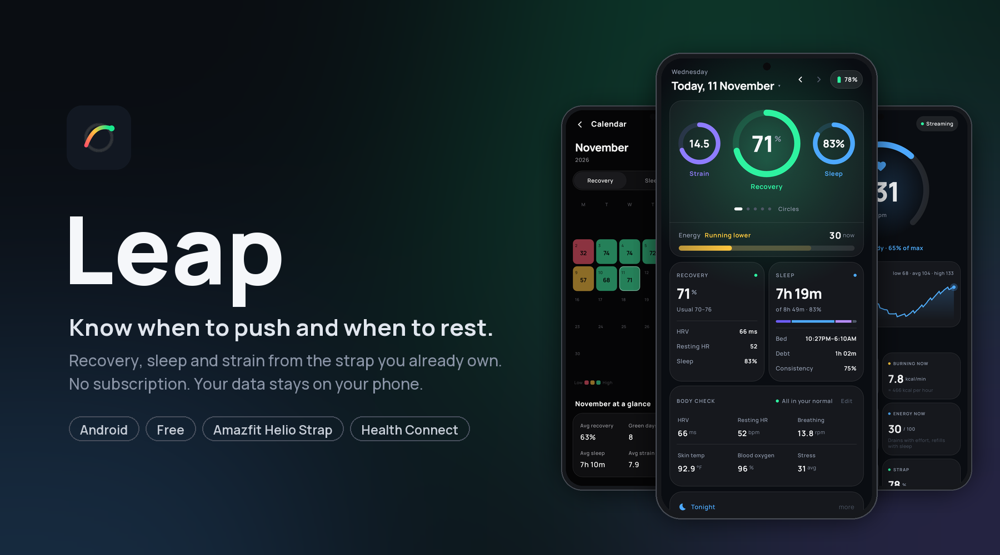
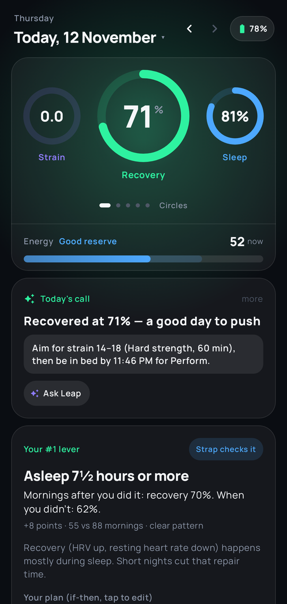
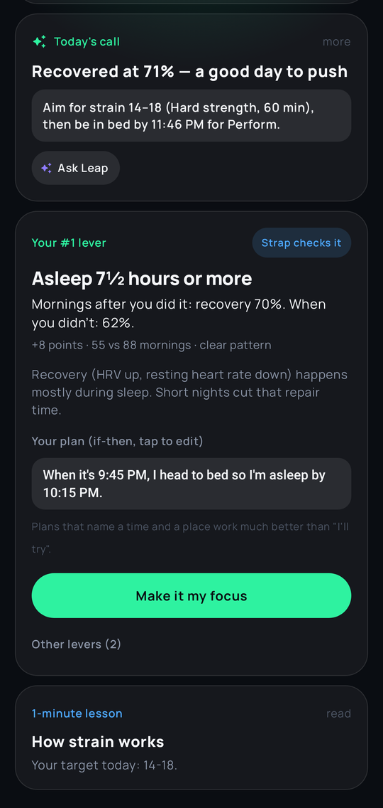
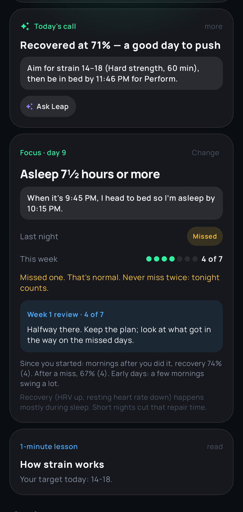
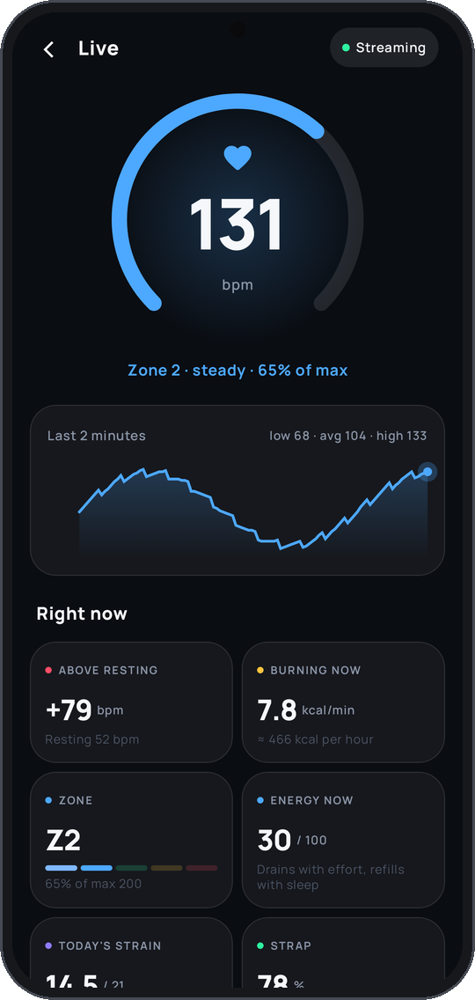
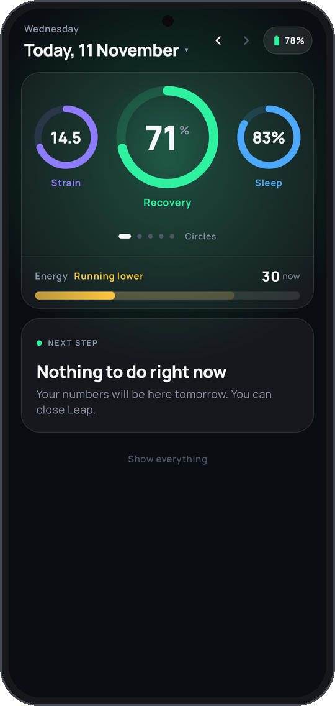
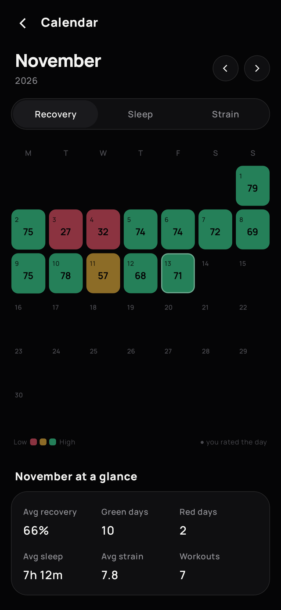
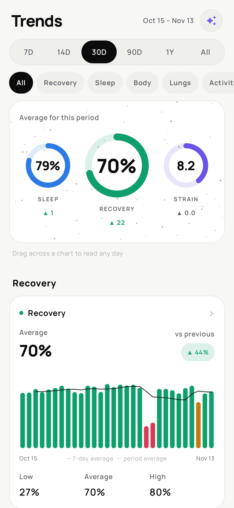
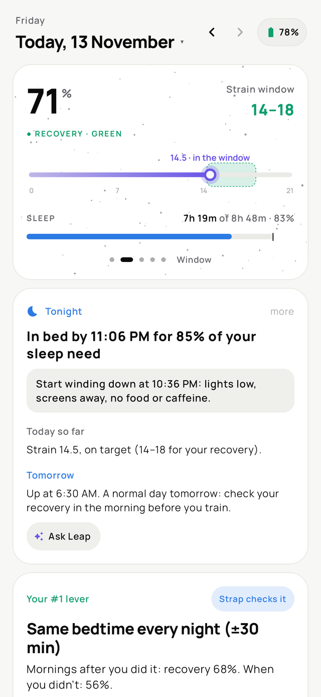

<p align="center">
  
</p>

<p align="center">
  <a href="../../releases/latest"><b>Download the APK</b></a> ·
  <a href="#getting-started">Get started</a> ·
  <a href="#features">Features</a> ·
  <a href="#accuracy-honestly">Accuracy</a>
</p>

---

**Leap** turns the heart-rate, sleep and HRV data from an **Amazfit Helio Strap** (or another watch or ring through Health Connect) into three daily scores, and tells you what to do with them:

| | |
|---|---|
| 🟢 **Recovery** 0–100% | overnight HRV, resting heart rate, breathing and sleep, compared with *your* normal |
| 🔵 **Sleep** | what you slept vs. what you needed, sleep debt, stages, consistency |
| 🟣 **Strain** 0–21 | minute-by-minute heart rate, plus every workout |

Then it helps you **change one habit at a time**: it finds the habit that moves *your* recovery the most, turns it into a simple plan, checks it each night, and shows you the payoff on your own numbers.

No account. No subscription. No cloud. Leap reads your data on your phone and keeps it there.

<p align="center">
  
  
  
  
</p>
<p align="center">
  
  
  
  
</p>
<p align="center"><sub>Screens show made-up demo data.</sub></p>

## Features

**Change one habit at a time** (new in 0.2)
- **Your #1 lever**: Leap compares your own nights and finds what lines up best with a good recovery (for example "asleep 7½ hours or more: 70% vs 58%")
- **One if-then plan** ("When it's 9:45 PM, I head to bed"), one quiet nudge at that time, and a nightly check. The strap checks sleep habits by itself
- **The payoff on your numbers**: recovery after the nights you did it vs the nights you didn't
- **Weekly review**: three strong weeks and the habit "graduates"; a hard week makes the plan smaller, not you a failure. No streaks, no shame: "never miss twice"
- **1-minute lessons**: what your most unusual number today means, what moves it, and one thing to try

**Every day**
- **Today**: three rings and one call for the day ("push", "steady" or "recover") with a strain target and a session; if Leap holds you back, it says why
- **Pick your tiles**: choose which body numbers show (HRV, resting HR, breathing, skin temp, blood oxygen, steps, sleep debt…)
- **Calm mode**: only your rings and one next step. Built to cut down on compulsive checking
- **Live heart rate**: a beating bpm pill on every screen while Leap is open, and a Live page with zone, calories per minute, energy and more
- Five score styles, three themes (Graphite, Space black, Space white), a home-screen widget and a story-size share card

**Training**
- **Today's session**: a suggested workout from your recovery, your last 7 days' load and the sports you actually do
- **Live workouts**: strain builds in real time, heart-rate zones, keeps going with the screen off
- Workout history with names, effort and notes

**Sleep**
- Sleep planner: tonight's need from your debt and today's strain, bedtime options and a wake alarm that can also buzz the strap
- Tomorrow forecast: move the bedtime slider, see the predicted recovery
- Naps, sleep edits, 7-night stats, calendar

**Insights**
- Journal with habit impact: which habits actually move your recovery
- Experiments: test one change (say, magnesium) on balanced on/off days
- Weekly report, Trends you can scrub with a finger, Leap Age
- **Build your own score** from 11 inputs, and check whether it means anything
- Optional AI coach (Claude, ChatGPT or Gemini) with your own key: one tap from Today, knows today's call and your focus habit

**Health extras**
- Overnight blood oxygen and finger-oximeter spot checks
- Peak-flow tracking with asthma-plan zones (imports the ePEF app)
- Health Connect: send your scores out, or read another wearable in

## How it works

```
Helio Strap ──▶ Gadgetbridge ──▶ exported database ──▶ Leap
                (open-source        (a folder on          (reads it, scores it,
                 companion app)       your phone)            shows it)

Other watch / ring ──▶ its own app ──▶ Health Connect ──▶ Leap
```

Leap never talks to Amazfit's servers. It reads the database that [Gadgetbridge](https://gadgetbridge.org) exports and asks Gadgetbridge to sync each time you open it. Live heart rate uses the strap's standard Bluetooth heart-rate signal.

## Getting started

1. **Download** the latest `Leap-vX.Y.Z.apk` from [Releases](../../releases/latest) and install it (Android 8.0+; allow "install unknown apps" for your browser or file manager).

**With a Helio Strap**

2. Pair the strap with **Gadgetbridge** (you need the strap's auth key; see the Gadgetbridge docs for Zepp OS devices).
3. In Gadgetbridge: turn on **auto-export** of the database to a folder, and turn on the **Intent API** sync and export triggers.
4. In Leap: **Settings → Gadgetbridge folder**, choose that export folder.
5. Wear the strap for about a week; recovery needs a baseline.

**With another watch or ring**

2. Let your device's app (Samsung Health, Fitbit, Oura, Garmin…) share with **Health Connect**.
3. In Leap: **Settings → Other wearable → Read from Health Connect**, and allow the permissions (allow "past data" for more than 30 days).
4. Leap shows what it found for each metric. Scores settle after about two weeks.

Have a Whoop export? Import the ZIP in Settings to keep your history and personalise the scores.

## Accuracy, honestly

- Leap's formulas were fitted on a long run of real Whoop data and checked on months the fit never saw.
- The Helio Strap's HRV reads about 15% below Whoop's; Leap corrects for it. Resting heart rate matches.
- The strap misses some awake time and deep sleep. Leap corrects awake time and *estimates* deep sleep, labelled as an estimate.
- Other wearables: Leap uses each device's own numbers, with no corrections, against your own normal. HRV and sleep stages differ most between brands.
- Live HRV is not possible with the Helio Strap: it sends heart rate about once a second, without beat-to-beat timing.
- The strap keeps only a few weeks of data. Sync at least every 2–3 days.

## Privacy

- Your health data stays on your phone. Nothing is uploaded unless you turn on Health Connect sync or the AI coach.
- The AI coach is off until you add your own API key. It sends a short summary of your numbers (no raw data) only to the provider you choose. Keys are encrypted with the Android Keystore.
- No accounts, analytics, trackers or ads.

## Feedback

Found a bug or have an idea? [Open an issue](../../issues). Device reports (which strap or watch, what works, what doesn't) are especially welcome.

## Disclaimer

Leap is free to download and use. The app's source code is not public. Leap is an independent project and **not a medical device**. Don't use it to diagnose or treat anything. It is not affiliated with or endorsed by WHOOP, Amazfit / Zepp Health or Gadgetbridge; those names only describe compatibility.

## Credits

- [Gadgetbridge](https://gadgetbridge.org) does the hard work of talking to the strap
- [Haze](https://github.com/chrisbanes/haze) for frosted-glass blur
- [Manrope](https://fonts.google.com/specimen/Manrope) typeface
